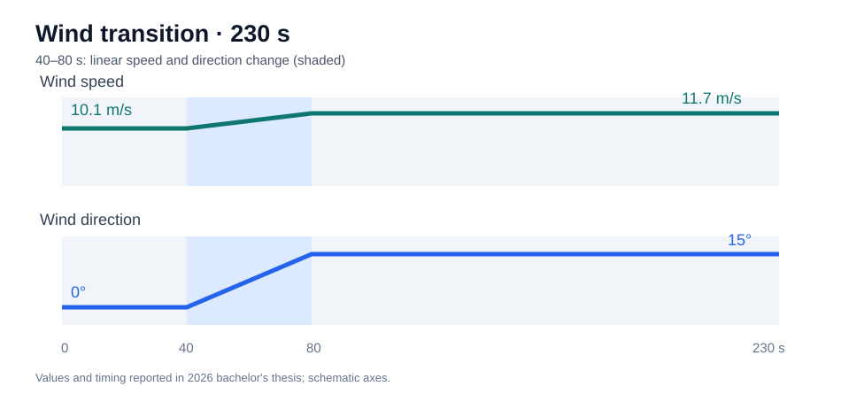
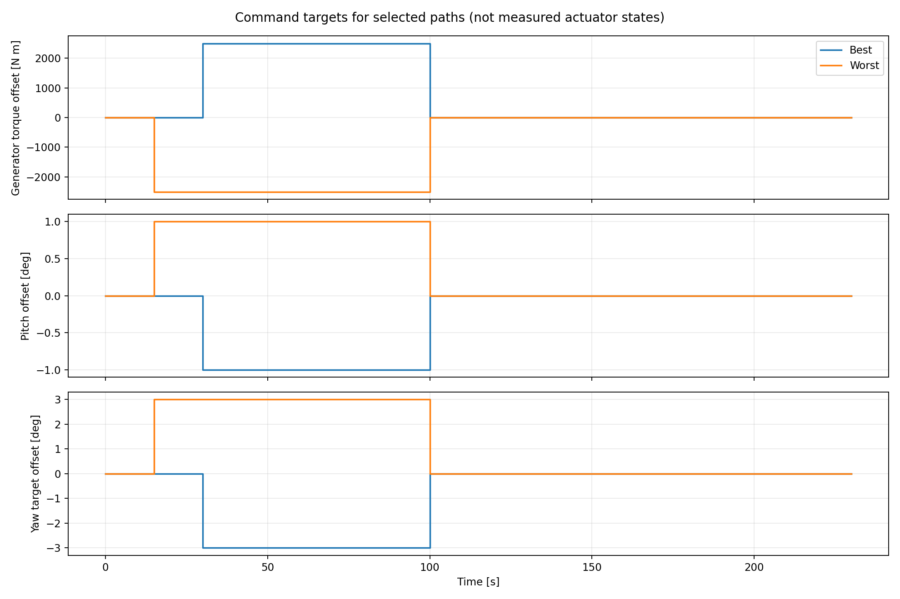
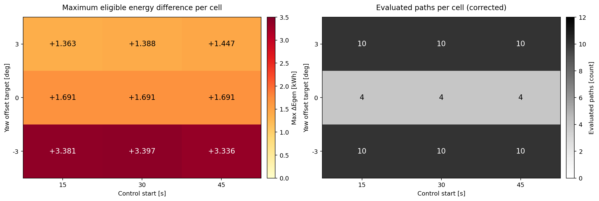
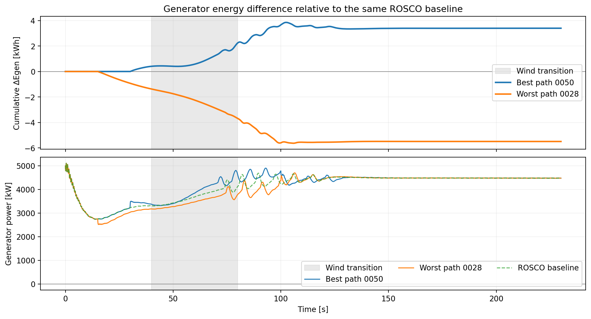
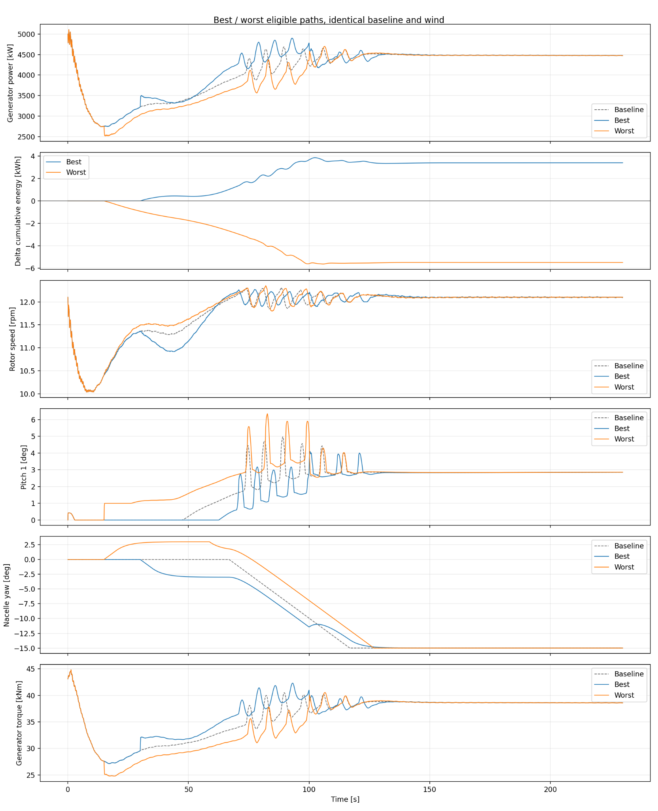

# 풍황 전환 시 풍력터빈 토크·피치·요 제어 경로의 에너지적 유불리 분석

**성균관대학교 기계공학부 · 2026 학사학위논문 연구**  
**NREL 5-MW Reference Turbine | OpenFAST v5.0.0 | ROSCO | Python | C (DISCON Wrapper)**  
[English README](README_EN.md) · [코드와 실험 설정](docs/reproducibility.md)


### 프로젝트 요약

| 항목 | 내용 |
|:--|:--|
| **연구 질문** | 동일한 풍황·초기 조건에서 토크·피치·요 제어 **경로**가 발전기 누적 전기에너지에 미치는 영향 |
| **구현** | 풍황 입력 생성, 시간별 토크·피치 오프셋 및 요각 참조 추종을 위한 [C DISCON 래퍼](controller/discon_offset_reference.c), 결과 검증·시각화 |
| **검증 범위** | 유한한 **72개** 경로 비교: 기준 대비 증가 26개 / 감소 46개 |
| **관측 결과** | 최고 **+3.3972 kWh (+1.2925%)**, 최저 **−5.4889 kWh (−2.0884%)** |

*실험은 한 가지 풍황 시나리오에서 수행된 오프라인 비교이며, 전역 최적 제어기나 구동기 소비전력을 포함한 순발전량 개선을 입증하지 않는다.*

## 1. 연구 목적과 질문

**같은 바람과 같은 초기 조건에서 출발해, 최종적으로 같은 운전 목표로 복귀하더라도 중간의 제어 경로가 다르면 누적 발전기 전기에너지가 달라지는가?**

풍속·풍향이 전환되는 동안에는 로터 관성, 공력 상태, 발전기 부하, 피치·요 구동 응답이 서로 영향을 준다. 그래서 전환 전후의 *유한한 시간 구간*에만 기존 제어 명령을 다르게 주고, 이후에는 기준 제어기로 되돌렸을 때 에너지 증가·감소가 어떻게 나타나는지 비교했다.

풍황이 일정해진 뒤에는 동일한 풍황과 기준 제어기가 정하는 **동일한 정상 운전 목표**를 향하도록 했다. 따라서 연구의 초점은 안정된 종단 운전점을 새로 만드는 것이 아니라, **풍황이 바뀌기 전후의 과도 구간에서 어떤 제어 경로로 그 운전 목표에 접근하는가**에 있다. 하지만 풍황과 명령을 같게 만든다고 실제 모든 상태가 즉시 일치하는 것은 아니다. 따라서 마지막 10초 동안 주요 상태의 기준 경로 대비 편차를 별도로 검사했다. 이 연구의 목적은 더 나은 실시간 제어기를 완성하는 것이 아니라, **전환 시점의 명령 경로 자체가 갖는 에너지적 유불리를 탐색**하는 것이다.

## 2. 접근 과정: Python 로터 동역학에서 OpenFAST–ROSCO로

연구 초반에는 Python에서 풍력터빈의 공력 출력과 로터 운동방정식을 직접 연결해, 발전기 저항토크·블레이드 피치·나셀 요 명령을 바꿨을 때 발전량이 어떻게 달라지는지 모사하려 했다. 출발점은 다음과 같은 **축소 로터 모델**이었다.

$$
P_{\mathrm{aero}}(t)=\frac{1}{2}\rho A V(t)^3 C_p\left(\lambda(t),\beta(t),\gamma_{\mathrm{err}}(t),\ldots\right),
\qquad \lambda(t)=\frac{\Omega(t)R}{V(t)}
$$

$$
J_{\mathrm{eq}}\dot{\Omega}(t)
= T_{\mathrm{aero}}(t)-T_{\mathrm{gen,eq}}(t)-T_{\mathrm{loss}}(t),
\qquad T_{\mathrm{aero}}=\frac{P_{\mathrm{aero}}}{\Omega}\quad(\Omega>0)
$$

여기서 $\rho$는 공기밀도, $A=\pi R^2$는 로터 수풍면적, $V$는 풍속, $C_p$는 공력 출력계수, $\lambda$는 주속비, $\beta$는 블레이드 피치각, $\gamma_{\mathrm{err}}$는 요 오정렬각이다. $\Omega$는 로터 각속도, $J_{\mathrm{eq}}$는 로터 측 등가 관성, $T_{\mathrm{gen,eq}}$는 로터 축으로 환산한 발전기 저항토크이며 $T_{\mathrm{loss}}$는 축계 손실의 단순화 표현이다. 위 식은 연구의 초기 물리적 사고를 설명하는 축소 표현이다.

가장 큰 문제는 $C_p$를 일정하게 취급할 수 없다는 점이었다. 풍속이 전환되면 $\lambda=\Omega R/V$가 변하고, 토크·피치·요 제어는 로터속도, 받음각, 요 오정렬 및 공력·구동계 응답을 서로 다르게 바꾼다. 단순 $C_p$ 가정이나 제한된 경험식만으로는 **순간 발전량뿐 아니라 제어 경로에 따른 과도응답과 누적 에너지 차이**를 신뢰성 있게 평가하기 어렵다고 판단했다. Python 축소모델에서 출발했지만 이를 최종 물리 모델로 채택하지 않은 이유다.

따라서 동역학 계산은 **NREL 5-MW Reference Wind Turbine**의 설계 매개변수와 모델 입력(로터·블레이드 형상, 관성, 공력·기계 특성 등)을 사용하는 **OpenFAST**에 맡기고, **ROSCO**를 기준 피드백 제어기로 선택했다. 이 선택은 단순 모델 대신 모든 물리 현상을 완벽하게 재현했다는 의미는 아니지만, 동일한 공개 참조 터빈에서 제어 명령에 따른 동적 응답을 일관되게 비교하기 위한 선택이었다. *NREL 5 MW는 실제 특정 발전소에서 측정한 운전 데이터가 아니라 공개된 연구용 참조 터빈 모델*이다. Python은 풍속·풍향 입력과 제어 오프셋 이벤트 생성, 결과 정리, 발전기 전력 적분과 비교를 담당하도록 역할을 바꾸었다.

이 전환 이후의 핵심 실험은 **동일한 5 MW 참조 터빈과 동일한 ROSCO 제어기를 유지한 상태에서, 풍황 전환 주변의 유한한 시간 구간에만 추가 명령을 가해 제어 경로를 달리하는 것**이었다. 풍황이 일정해진 종단 구간에는 오프셋을 해제해 양쪽 모두 같은 기준 운전 목표를 향하도록 했으며, 실제 상태의 근접 여부는 별도로 검사했다.

## 3. 핵심 구현: ROSCO 기준 제어 위의 유한시간 오프셋

OpenFAST의 터빈 동역학과 ROSCO의 기본 피드백 제어 알고리즘은 **기존 소프트웨어**를 사용했다. 이 연구에서 별도로 구성·연동한 부분은 **(a) 풍황 전환 입력 생성, (b) ROSCO 명령 위의 시간별 토크·피치 오프셋 및 요 목표각 보정, (c) 기준 요각 추종과 종단 복귀 검증**이다.

```text
풍속·풍향 JSON → InflowWind → OpenFAST (NREL 5-MW 터빈 동역학)
                                   ↑                  │ 상태값
                                   │                  ↓
                           ServoDyn ← DISCON wrapper ← ROSCO 기본 제어
                                       │
                           시점별 ΔTg · Δβ · Δγ + 기준 요각 추종
```

요청 명령의 구조는 다음과 같이 표현할 수 있다. `limit`는 해당 출력에 적용한 포화·명령 변화율 제한을 뜻한다.

$$
T_{g,\mathrm{cmd}}=\mathrm{limit}\big(T_{g,\mathrm{ROSCO}}+\Delta T_g(t)\big),
\qquad
\beta_{\mathrm{cmd}}=\mathrm{limit}\big(\beta_{\mathrm{ROSCO}}+\Delta\beta(t)\big)
$$

요 제어는 기준 실행에서 얻은 요각 참조에 $\Delta\gamma(t)$를 더해 **목표 요각**을 구성하고, 이를 요속도 명령 보정으로 추종하는 구조다. 아래의 개념식은 구현 구조를 설명하기 위한 것이며, 실제 명령에는 제한과 동적 응답이 작용한다.

$$
\gamma_{\mathrm{target}}(t)=\gamma_{\mathrm{ref,baseline}}(t)+\Delta\gamma(t)
$$

- **발전기 저항토크**: ROSCO 토크 명령에 $\Delta T_g$를 더한 뒤 포화·명령 변화율 제한 적용. 이 값은 *발전기 전기적 부하*이며 외부 보조 모터의 가속 토크가 아니다.
- **블레이드 피치**: ROSCO 피치 명령에 $\Delta\beta$를 더한 뒤 포화·변화율 제한 적용.
- **나셀 요**: 각도 오프셋 $\Delta\gamma$를 요 목표에 적용하고, 기준 실행에서 구한 요각 궤적을 따라 복귀하도록 **요속도 명령 보정**을 구성. 요각 자체를 순간 변경하는 방식이 아니다.
- **개입·해제**: $t_{on}$에 오프셋을 설정하고 $t_{off}$에 **0으로 해제**한다. 개입 전에는 기준 제어와 같은 경로를 유지하고, 해제 후에는 동일한 최종 풍황·운전 목표를 향하도록 했다. 이후 실제 상태가 기준 경로에 얼마나 근접했는지 별도로 검사했다.

실험 래퍼에 기록된 기본값은 요 추종 이득 **0.2 s⁻¹**, 요속도 제한 **±0.3°/s**, 피치 명령 변화율 **8°/s**, 토크 명령 변화율 **15,000 N·m/s**다. 이는 적용 명령의 제한값이다.

**중요한 비교상의 한계:** 72개 실험의 요 보정은 사전에 계산한 **기준 요각 궤적**을 참조했다. 개입 이후에는 오프셋이 0이더라도 참조 추종의 효과가 남을 수 있다. 따라서 측정한 에너지 차이는 *오프셋만의 순수한 인과효과*가 아니라 **오프셋 + 요 추종 구조를 포함한 대안 경로 전체**와 기준 경로의 차이다. 기준 궤적 사전 확보는 탐색적 오프라인 비교 조건이다.


### C 기반 DISCON 래퍼: 실제 구현 소스

**[소스코드: `controller/discon_offset_reference.c`](controller/discon_offset_reference.c)**는 원래 ROSCO의 `DISCON` 함수를 먼저 호출한 뒤, `CONTROL_SCHEDULE`이 가리키는 이벤트 CSV를 읽어 토크·피치 오프셋을 적용하고 출력 포화·변화율을 제한한다. `YAW_REFERENCE_CSV`가 설정되면 별도 기준 실행의 요각 CSV를 시간 보간하여, 요각 오차에 비례하는 **요속도 보정**을 적용한다. 설정하지 않으면 코드 내부의 가상 기준 요각 방식으로 동작한다. `CONTROL_LOG`를 지정하면 ROSCO 기본 명령과 수정된 명령을 CSV로 기록할 수 있다.

- [ServoDyn 및 ROSCO 설정 파일](configs/historical/)에는 외부 DLL 호출과 기본 피드백 제어 설정을 보관했다. 제어 경로별 차이는 이득 테이블을 수정한 것이 아니라 **이벤트 CSV에 지정한 오프셋 크기와 적용 시점**으로 구성했다.
- [코드·설정 및 실험 데이터 안내](docs/reproducibility.md)에서는 C 래퍼 입력 형식과 결과 확인 방법을 정리했다.



## 4. 시나리오와 탐색 범위

| 조건 | 값 |
|:--|:--|
| 풍속 / 풍향 | **10.1 → 11.7 m/s / 0 → 15°** |
| 풍황 구간 | 0–40 s 초기 일정 → **40–80 s 선형 전환** → 80–230 s 종단 일정 |
| 기준 경로 | 동일 풍황·초기 조건에서 ROSCO 기준 제어 실행 |
| 제어 개입 시점 | **15 / 30 / 45 s** (전환 이전 개입도 시험) |
| 제어 해제 시점 | **75 / 95 / 100 s** (실험군에 따라 다름) |
| 오프셋 크기 | 토크 **±2,500 N·m**, 피치 **±1°**, 요 **±3°** |
| 평가 경로 | 요 단독 12 + 토크 단독 6 + 피치 단독 6 + 복합 48 = **72개** |

72개는 위 격자의 **실제로 평가한 이산 경로**이며, 모든 풍황·명령·시각의 전역 탐색은 아니다. 전체 명령·성적은 [`search_results.csv`](data/openfast_72/search_results.csv)에 있다.



*위 그림은 명령 오프셋의 시점·크기이며 실제 터빈 상태가 즉각 같은 폭으로 바뀐다는 뜻이 아니다. 응답 지연이 있는 채로 따라간다*

## 5. 결과: 같은 풍황, 다른 누적 에너지

평가 지표는 발전기 출력 `GenPwr`의 적분 차이다.

$$
\Delta E_{gen}=\frac{1}{3600}\int_{0}^{230}\left(P_{candidate}(t)-P_{baseline}(t)\right)\,dt \quad [\mathrm{kWh}]
$$

(출력은 kW, 시간은 s; 실제 계산은 사다리꼴 적분.)

| 지표 | 결과 |
|:--|--:|
| ROSCO 기준 발전기 전기에너지 | **262.8330 kWh** |
| 증가 / 감소 경로 | **26 / 46개** |
| 평가 경로 중 최고 **0050** | **+3.3972 kWh (+1.2925%)** |
| 평가 경로 중 최저 **0028** | **−5.4889 kWh (−2.0884%)** |
| 최고–최저 차이 | **8.8861 kWh** |



*맵의 각 칸은 (개입시각, 요 오프셋)별 **최고 ΔE**를 표시한다. 칸 안의 모든 후보가 이득이었다는 뜻은 아니다.*

| 경로 | 구간 | 토크 $\Delta T_g$ | 피치 $\Delta\beta$ | 요 $\Delta\gamma$ | 최종 $\Delta E_{gen}$ |
|:--|:--|--:|--:|--:|--:|
| **0050 최고** | 30–100 s | +2,500 N·m | −1° | −3° | **+3.3972 kWh** |
| **0028 최저** | 15–100 s | −2,500 N·m | +1° | +3° | **−5.4889 kWh** |





최고 경로 0050은 초기 손실을 회복한 경로가 아니라 개입 후 이득이 형성된 경로다. 실질적인 초기 손실(최소 누적 차이 $<-0.01$ kWh)이 있었지만 최종 차이가 양수로 바뀐 경로도 **5개** 관찰되었다. 이러한 결과는 일시적인 에너지 손실이 반드시 최종 손실을 뜻하지는 않는다는 연구 가설을 뒷받침하지만, 모든 제어 경로의 선행 손실이 회복된다는 뜻은 아니다. **유리한 부호나 시점은 이번 시나리오·명령 격자에서 관측한 결과이지 일반적인 최적 제어법칙이 아니다.**

### 종단 상태 확인

오프셋 해제와 종단 일정 풍황만으로 동일 상태가 자동 보장되지는 않으므로, **마지막 10초** 동안 기준 경로 대비 주요 상태의 최대 편차가 로터속도 ≤0.10 rpm, 피치 ≤0.15°, 요각 ≤0.30°, 요속도 ≤0.035°/s, 발전기 토크 ≤0.40 kN·m인지 검사했다. 저장된 72개 검색 결과는 모두 이 **축소 상태 필터**를 통과했다. 이는 전체 구조 상태의 완전 일치나 모든 안전·정격 제약의 증명이 아니다.

## 6. 결과 재현과 사용 파일

이 저장소는 **72개 실험의 저장 결과(CSV·JSON)와 재검증·시각화 코드**를 중심으로 정리했다. 시뮬레이션을 준비하면서 적용한 입력 변경의 핵심은 다음과 같다.

| 파일·설정 | 역할 |
|:--|:--|
| [`configs/openfast72_wind.json`](configs/openfast72_wind.json) | 풍속·풍향의 초기값, 최종값, 전환 시작·종료 시각 정의 |
| [최고 경로](configs/openfast72_best_schedule.json) / [최저 경로](configs/openfast72_worst_schedule.json) JSON | 토크·피치·요 오프셋의 크기, 개입·해제 시각 지정 |
| OpenFAST `.fst` / InflowWind | 전체 해석 시간과 생성된 시간별 균일 풍황 입력 연결 |
| [ServoDyn / ROSCO `DISCON.IN`](configs/historical/) | 외부 DISCON 인터페이스 및 ROSCO 피드백·요 제어 연결(기존 실행 설정 기록) |
| [C DISCON 래퍼 소스](controller/discon_offset_reference.c) | 기존 ROSCO 출력에 오프셋·제한·요각 참조 추종 보정 적용 |
| Python 스크립트 | 입력 생성, CSV 분석 결과 검사 및 그래프 재생성 |

저장된 결과를 검증하고 그림 및 풍황·이벤트 입력을 생성하려면:

```bash
python -m pip install -r requirements.txt
python scripts/check_openfast72_data.py
python scripts/plot_openfast72_from_csv.py
python scripts/prepare_inputs.py --events configs/openfast72_best_schedule.json
```

현재 저장소에서 **72개 실험 결과 분석·시각화와 C 제어 래퍼 구현 확인**이 가능하다. 시뮬레이션 전체 실행에는 별도 OpenFAST–ROSCO 모델 및 실행 환경이 필요하다. 자세한 입력과 파일 구성은 [실험 코드·설정 안내](docs/reproducibility.md)에 정리했다. 

**원자료:** [72개 후보 결과](data/openfast_72/search_results.csv) · [선택 및 종단 상태 검증](data/openfast_72/search_selection.json) · [최고 시계열](data/openfast_72/best_timeseries.csv) · [최저 시계열](data/openfast_72/worst_timeseries.csv)

## 7. 결론 및 연구를 통해 얻은 경험

본 연구에서는 동일한 풍황과 초기 조건에서도 **토크·피치·요 제어 명령의 크기, 방향, 적용 시점에 따라 누적 발전기 전기에너지가 달라질 수 있음**을 확인했다. 72개 제어 경로 중 26개에서 기준 대비 발전량 증가, 46개에서 감소가 나타났으며, 최고 +3.3972 kWh와 최저 −5.4889 kWh의 차이를 보였다. 이를 통해 중요한 것은 특정 제어 입력의 크기만이 아니라, **풍황 변화에 맞춰 언제 개입하고 언제 해제하며, 그 과정에서 터빈이 어떤 상태 궤적을 거치는가**라는 점을 확인할 수 있었다.

연구 초반에는 공력 출력식과 로터 운동방정식을 이용해 Python에서 발전량과 제어 효과를 직접 모사하려 했다. 그러나 출력계수 $C_p$가 운전 상태에 따라 달라지고, 발전기 토크·피치·요 제어가 공력 및 회전자 동역학에 복합적으로 작용한다는 점에서 단순 모델의 한계를 경험했다. 이 과정에서 **수식을 구현하는 것과 실제 시스템의 동적 거동을 신뢰성 있게 모사하는 것은 다른 문제**라는 점을 이해했고, 연구 목적에 적합한 물리 모델을 선택하는 것이 중요하다는 것을 배웠다.

이후 OpenFAST–ROSCO 환경으로 전환하면서 기존 피드백 제어기를 새로 설계하기보다, **ROSCO의 제어 출력을 유지한 채 필요한 시점에 추가 오프셋을 적용하는 구조**를 구현했다. 풍속·풍향 입력을 구성하고, 토크·피치·요 명령을 시간별로 조합하며, 실제 터빈의 동적 응답과 누적 발전량을 비교하는 과정을 경험했다. 특히 오프셋을 해제하더라도 로터속도나 요각 등의 상태가 즉시 기준 경로로 돌아오지 않는다는 점을 고려해 종단 상태를 별도로 검사했다. 이를 통해 제어 명령과 실제 시스템 응답을 구분하고, 비교 실험의 조건을 일관되게 유지하는 것의 중요성을 확인했다.

후속 연구에서는 다양한 풍속·풍향 변화와 초기 상태로 탐색 범위를 확대하고, 오프셋과 요각 추종의 영향을 분리한 대조 실험을 수행할 필요가 있다. 나아가 구동기 에너지와 미래 풍황 예측 오차까지 고려한다면, **어떤 풍황과 초기 상태에서 어떤 제어 경로가 에너지적으로 유리한지 판단하는 기준**으로 연구를 발전시킬 수 있을 것이다.

**참고:** [OpenFAST](https://github.com/OpenFAST/openfast) · [ROSCO](https://github.com/NREL/ROSCO) · [NREL 5-MW Reference Turbine (Jonkman et al., 2009)](https://www.nrel.gov/docs/fy09osti/38060.pdf)
