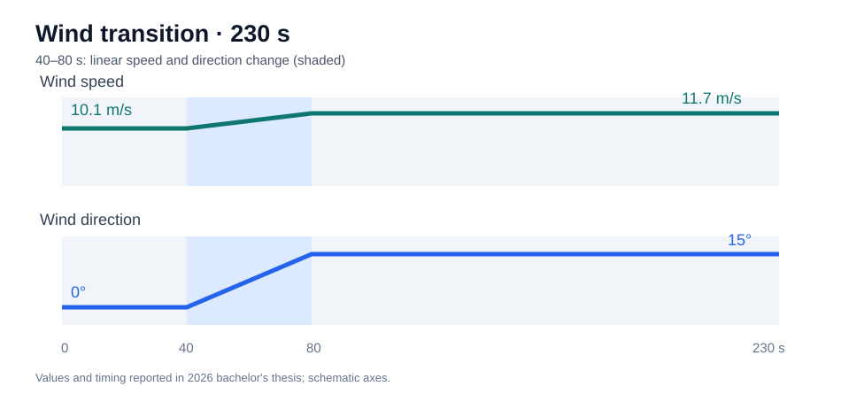
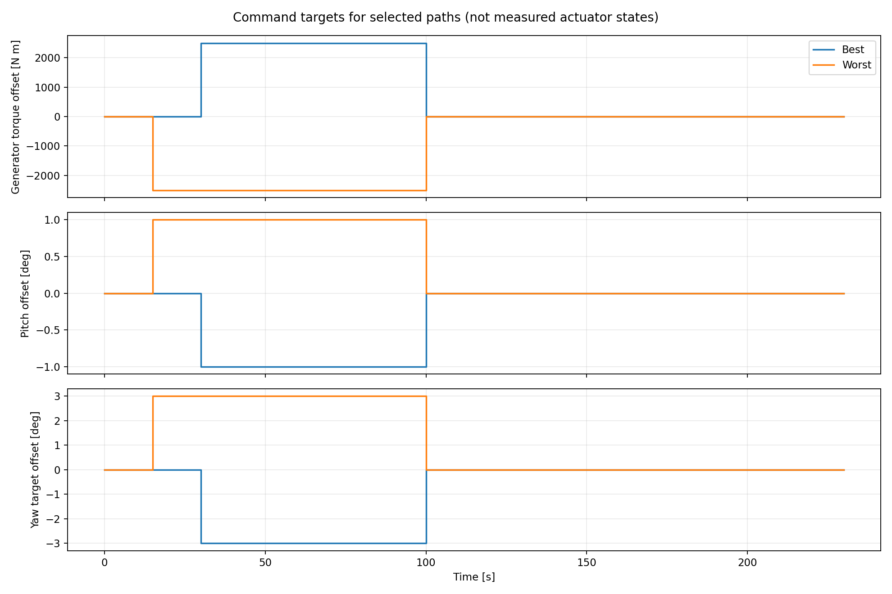
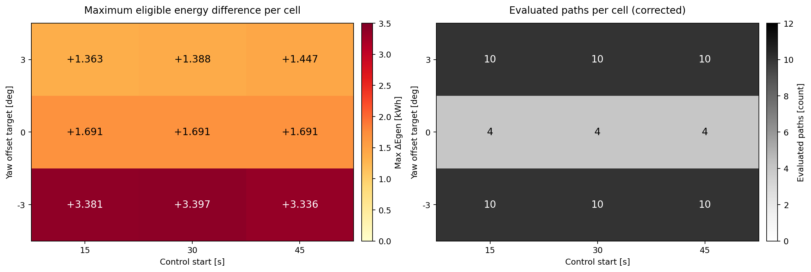
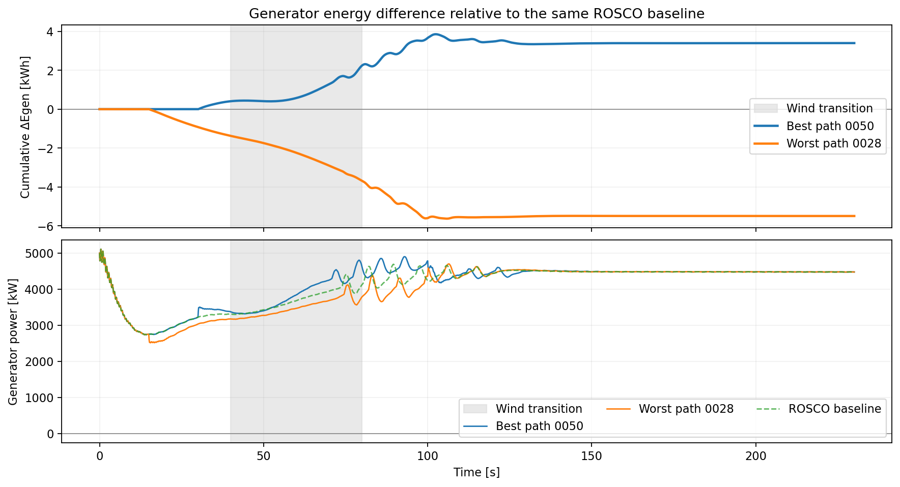
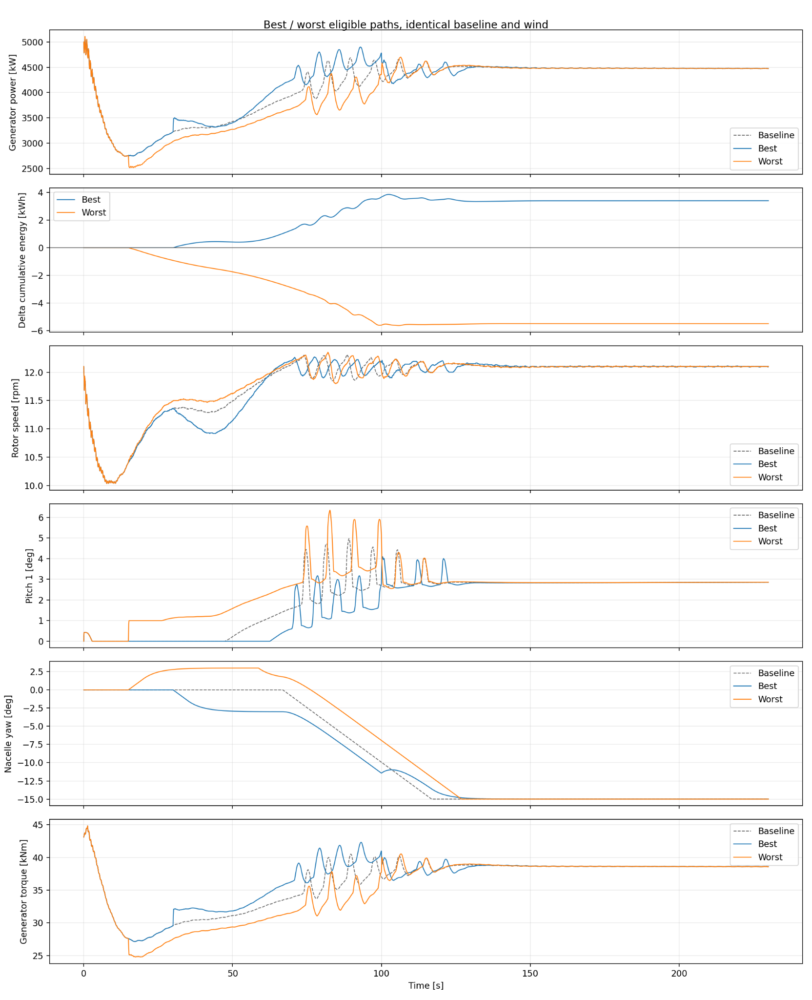

# Energy Gains and Losses Across Torque–Pitch–Yaw Control Paths During Wind Transitions

**Bachelor's thesis research (2026) · Mechanical Engineering, Sungkyunkwan University**  
**NREL 5-MW Reference Turbine | OpenFAST v5.0.0 | ROSCO | Python | C (DISCON Wrapper)**  
[한국어 README](README.md) · [Code and experiment setup](docs/reproducibility.md)


### Project at a Glance

| Item | Summary |
|:--|:--|
| **Research question** | How do different torque–pitch–yaw **control paths** affect cumulative generator electrical energy under identical wind and initial conditions? |
| **Implementation** | Wind input preparation, [C DISCON wrapper](controller/discon_offset_reference.c) for scheduled torque/pitch offsets and yaw-reference tracking, validation and plotting |
| **Evaluation** | **72** finite control paths: 26 above / 46 below the baseline |
| **Observed results** | Best **+3.3972 kWh (+1.2925%)**, worst **−5.4889 kWh (−2.0884%)** |

*This is an offline comparison under one wind scenario, not proof of a globally optimal controller or net energy gains after actuator consumption.*

## 1. Research objective

**Can finite-duration control interventions produce different cumulative generator electrical energy, even when the wind and initial state are identical and the turbine returns toward the same final operating target?**

Aerodynamic conditions, rotor inertia, generator loading, blade-pitch response, and yaw response are coupled during wind transitions. This study compares **control trajectories**, not merely individual instantaneous setpoints. All candidates use the same wind profile and initial conditions; the additional commands are released so that the terminal states can approach the baseline.

The constant final wind defines a shared target **under the selected baseline controller**. Thus the experiment changes the **transient path before and around the transition**, not the intended steady operating point. Identical final inputs alone do not guarantee identical physical states. A reduced terminal-state check is therefore part of the comparison. The goal is to **map energy advantages and disadvantages of tested control paths**, not to claim a deployable optimal controller.

## 2. Modeling decisions: from rotor equations in Python to OpenFAST–ROSCO

My first approach was to implement a reduced-order aerodynamic and rotor-dynamics model in Python, then simulate how generator resistive torque, blade pitch, and nacelle yaw commands might change electrical production. The starting equations were:

$$
P_{\mathrm{aero}}(t)=\frac{1}{2}\rho A V(t)^3 C_p\left(\lambda(t),\beta(t),\gamma_{\mathrm{err}}(t),\ldots\right),
\qquad \lambda(t)=\frac{\Omega(t)R}{V(t)}
$$

$$
J_{\mathrm{eq}}\dot{\Omega}(t)
= T_{\mathrm{aero}}(t)-T_{\mathrm{gen,eq}}(t)-T_{\mathrm{loss}}(t),
\qquad T_{\mathrm{aero}}=\frac{P_{\mathrm{aero}}}{\Omega}\quad(\Omega>0)
$$

Here $\rho$ is air density, $A=\pi R^2$ is rotor swept area, $V$ is wind speed, $C_p$ is aerodynamic power coefficient, $\lambda$ is tip-speed ratio, $\beta$ is blade pitch, and $\gamma_{\mathrm{err}}$ is yaw misalignment. $\Omega$ is rotor angular speed, $J_{\mathrm{eq}}$ the rotor-side equivalent inertia, $T_{\mathrm{gen,eq}}$ the generator resistive torque referred to the rotor shaft, and $T_{\mathrm{loss}}$ a simplified mechanical-loss term. These are conceptual reduced-order equations.

The difficulty was that **$C_p$ is not constant**. During a wind transition, $\lambda=\Omega R/V$ changes, while torque, pitch, and yaw commands alter rotor speed, local aerodynamic conditions, misalignment, and drivetrain responses. A fixed $C_p$ or an assumed empirical curve could not reliably quantify the **transient response and accumulated energy difference between command trajectories**. I therefore did not use this initial Python approximation as the final physical model or treat its unvalidated output as a result.

Instead, I used **OpenFAST** with the publicly documented design parameters and input assets of the **NREL 5-MW Reference Wind Turbine** (blade/rotor geometry, inertial properties, aerodynamic and mechanical model inputs), and chose **ROSCO** as the baseline feedback controller. *The NREL 5-MW model is a research reference turbine, not measured operational data from a particular commercial wind farm.* Python was retained to prepare wind inputs and offset schedules, process simulation outputs, and integrate generator electrical power. The 72 reported cases are from the OpenFAST-based study, not the original simplified Python model.

With the turbine model and baseline controller held fixed, the central experiment became **changing only the finite-duration command path around the wind transition**. Offsets were released during the constant final-wind phase so all candidates targeted the same baseline operating condition; actual terminal-state proximity was checked separately.

## 3. What I implemented on top of the existing software

I **did not develop OpenFAST's turbine physics or ROSCO's feedback algorithm**. My additions were **(1) a controlled wind-speed/direction input, (2) scheduled offsets on ROSCO torque, pitch, and yaw commands, and (3) baseline yaw-reference tracking and terminal-state comparison**.

```text
Wind JSON → InflowWind → OpenFAST turbine dynamics
                             ↑            │ turbine states
                             │            ↓
                         ServoDyn ← DISCON wrapper ← ROSCO feedback
                                       │
                          scheduled ΔTg · Δβ · Δγ and yaw tracking
```

The requested generator-torque and blade-pitch commands are represented by the following conceptual relations. `limit` denotes the applied command saturation and rate limiting.

$$
T_{g,\mathrm{cmd}}=\mathrm{limit}\big(T_{g,\mathrm{ROSCO}}+\Delta T_g(t)\big),
\qquad
\beta_{\mathrm{cmd}}=\mathrm{limit}\big(\beta_{\mathrm{ROSCO}}+\Delta\beta(t)\big)
$$

For yaw, a scheduled angle offset is added to the **precomputed baseline yaw-angle reference**, and the resulting target is approached through yaw-rate correction rather than an instantaneous angle change:

$$
\gamma_{\mathrm{target}}(t)=\gamma_{\mathrm{ref,baseline}}(t)+\Delta\gamma(t)
$$

- **Generator resistive torque:** apply $\Delta T_g$ on top of the ROSCO generator torque command, with saturation and command-rate limiting. This is *electrical generator loading*, not external assist-motor torque.
- **Blade pitch:** add $\Delta\beta$ to the ROSCO pitch command, with saturation and slew-rate limiting.
- **Nacelle yaw:** apply a target-angle offset $\Delta\gamma$ through **yaw-rate correction** and baseline yaw-trajectory tracking; the nacelle angle is not changed instantaneously.
- **Schedule:** set the offsets at $t_{on}$ and reset them to zero at $t_{off}$. Compare the resulting state convergence during the constant final-wind segment.

The recorded wrapper settings include yaw tracking gain **0.2 s⁻¹**, maximum yaw rate **±0.3°/s**, pitch command-rate limit **8°/s**, and torque command-rate limit **15,000 N·m/s**. These are experimental command limits, not measured actuator costs or certified hardware behavior.

**Important confounder:** The 72-path yaw correction uses a **precomputed baseline yaw-angle trajectory**. After the first intervention, reference tracking can still affect the run even when the explicit offset is zero. Thus, the reported difference compares the **complete alternative offset-plus-tracking structure** against the baseline; it does not isolate the causal effect of offsets alone. A precomputed reference is an offline comparison assumption, not a real-time forecast.


### C DISCON Wrapper: Implementation Source

The **[C source: `controller/discon_offset_reference.c`](controller/discon_offset_reference.c)** first invokes the original ROSCO `DISCON` routine. It then reads the event CSV specified by `CONTROL_SCHEDULE`, applies scheduled generator-torque and blade-pitch offsets, and enforces command saturation and rate limits. When `YAW_REFERENCE_CSV` is set, the wrapper interpolates a baseline-run yaw-angle CSV and adds a **yaw-rate correction** based on the tracking error; otherwise it uses its virtual-baseline yaw mode. `CONTROL_LOG` can record the original ROSCO commands and modified outputs.

- [ServoDyn and ROSCO configuration files](configs/historical/) document the external DLL interface and baseline feedback setup. The candidate control paths differ through **scheduled offsets and intervention times**, not changes to the ROSCO gain tables.
- [Code, configuration, and data guide](docs/reproducibility.md) describes wrapper inputs and how to inspect the archived results.



## 4. Wind scenario and 72 evaluated trajectories

| Parameter | Value |
|:--|:--|
| Wind speed / direction | **10.1 → 11.7 m/s / 0 → 15°** |
| Timeline | 0–40 s constant → **40–80 s linear transition** → 80–230 s constant |
| Baseline | Unchanged ROSCO feedback with matched wind/initial conditions |
| Intervention times | **15 / 30 / 45 s** (including pre-transition interventions) |
| Release times | **75 / 95 / 100 s**, depending on experiment group |
| Offset magnitudes | Torque **±2,500 N·m**, pitch **±1°**, yaw **±3°** |
| Evaluated cases | 12 yaw-only + 6 torque-only + 6 pitch-only + 48 combined = **72** |

This is a **finite predefined grid**, not exhaustive optimization over all wind profiles, continuous amplitudes, timings, or command sequences. See [`search_results.csv`](data/openfast_72/search_results.csv).



*These are requested command offsets, not instantaneous physical actuator responses.*

## 5. Results under the same wind transition

Generator electrical-energy difference is evaluated by trapezoidal integration:

$$
\Delta E_{gen}\,[\mathrm{kWh}]=\frac{1}{3600}\int_{0}^{230}\big(P_{candidate}(t)-P_{baseline}(t)\big)\,dt
$$

where power is in kW and time is in seconds.

| Metric | Result |
|:--|--:|
| ROSCO baseline generator energy | **262.8330 kWh** |
| Positive / negative paths | **26 / 46** |
| Best evaluated path **0050** | **+3.3972 kWh (+1.2925%)** |
| Worst evaluated path **0028** | **−5.4889 kWh (−2.0884%)** |
| Best–worst spread | **8.8861 kWh** |



*Each map cell shows the **maximum** energy difference among paths with the same intervention time and yaw offset. It does not imply that every path in the cell gained energy.*

| Case | Active interval | Torque offset | Pitch offset | Yaw offset | Final ΔEgen |
|:--|:--|--:|--:|--:|--:|
| **0050 / best** | 30–100 s | +2,500 N·m | −1° | −3° | **+3.3972 kWh** |
| **0028 / worst** | 15–100 s | −2,500 N·m | +1° | +3° | **−5.4889 kWh** |





The best case did **not** start with an energy loss that was later repaid; it developed a positive difference after intervention. Five sampled paths had a substantive initial energy deficit (minimum cumulative difference below −0.01 kWh) but ended with a positive difference. This supports examining path-dependent recovery, not an assumption that every initial loss will be recovered. No universal optimal command direction follows from this single wind profile.

### Reduced terminal-state check

Over the **final 10 seconds**, the recorded maximum baseline-relative deviations were checked against rotor speed **0.10 rpm**, pitch **0.15°**, yaw angle **0.30°**, yaw rate **0.035°/s**, and generator torque **0.40 kN·m**. All 72 search records passed these study-defined **reduced-state filters**. This does not establish equivalence of all structural states or strict compliance with every power/load limit.

## 6. Reproducibility and key files

This repository focuses on **stored results from 72 evaluated paths (CSV/JSON), consistency checks, and postprocessing**. The experiment used the following input and control connections:

| File / setting | Role |
|:--|:--|
| [`openfast72_wind.json`](configs/openfast72_wind.json) | Initial/final wind, transition timing, and sampling |
| [Best](configs/openfast72_best_schedule.json) / [worst](configs/openfast72_worst_schedule.json) event JSON | Magnitudes and application/release times of torque, pitch, and yaw offsets |
| OpenFAST `.fst` / InflowWind | Simulation horizon and generated time-dependent uniform wind |
| [ServoDyn / ROSCO `DISCON.IN`](configs/historical/) | Archived external DISCON interface and baseline feedback/yaw configuration |
| [C DISCON wrapper source](controller/discon_offset_reference.c) | Call the existing ROSCO controller and apply scheduled offsets, limits, and yaw-reference tracking |
| Python scripts | Input preparation, saved-data validation, and regeneration of plots |

You can check the supplied 72-path records, regenerate summary figures, and prepare the wind/schedule inputs:

```bash
python -m pip install -r requirements.txt
python scripts/check_openfast72_data.py
python scripts/plot_openfast72_from_csv.py
python scripts/prepare_inputs.py --events configs/openfast72_best_schedule.json
```

The repository supports **analysis and visualization of the 72 archived cases and inspection of the custom C control wrapper**. Running the full OpenFAST simulations additionally requires the turbine model and an OpenFAST–ROSCO runtime. See the [code and configuration guide](docs/reproducibility.md).

**Data:** [72 candidate results](data/openfast_72/search_results.csv) · [selection and terminal checks](data/openfast_72/search_selection.json) · [best time history](data/openfast_72/best_timeseries.csv) · [worst time history](data/openfast_72/worst_timeseries.csv)

## 7. Conclusion and Lessons Learned

This study demonstrated that **the magnitude, direction, and timing of generator torque, blade pitch, and nacelle yaw control commands can affect cumulative electrical energy generation**, even under identical wind conditions and initial states. Among the 72 control paths evaluated, 26 produced more energy than the baseline, while 46 produced less, with the best and worst cases showing differences of +3.3972 kWh and −5.4889 kWh, respectively. These results suggest that energy performance depends not only on the magnitude of individual control inputs, but also on **when control actions are initiated and released, and how the turbine's dynamic states evolve throughout the transition**.

At the beginning of this research, I attempted to simulate power generation and control effects directly in Python using the aerodynamic power equation and rotor rotational dynamics. However, I encountered limitations in this simplified approach because the power coefficient $C_p$ varies with operating conditions, while generator torque, blade pitch, and yaw control interact through coupled aerodynamic and rotor dynamics. This experience helped me recognize that **implementing physical equations is not the same as accurately representing the dynamic behavior of a complex system**. It also highlighted the importance of selecting a physical model appropriate for the research objective.

After transitioning to the OpenFAST–ROSCO environment, I implemented a control architecture that **preserved the existing ROSCO feedback controller while applying additional command offsets at selected times**, rather than developing an entirely new feedback controller. I gained experience configuring wind speed and direction profiles, scheduling combinations of torque, pitch, and yaw offsets, and evaluating the resulting turbine dynamics and cumulative energy generation. In particular, I recognized that removing a control offset does not immediately return the rotor speed, yaw angle, or other dynamic states to their baseline trajectories. I therefore incorporated terminal-state checks to evaluate their convergence toward the baseline. This process reinforced the importance of distinguishing commanded inputs from actual system responses and maintaining consistent conditions for meaningful comparisons.

Future work should extend the analysis to a wider range of wind speed and direction transitions and initial operating conditions. Additional control experiments are also needed to separate the effects of command offsets from those of baseline yaw-reference tracking. Furthermore, incorporating actuator energy consumption and wind prediction uncertainty would help develop **a systematic framework for identifying which control paths are energetically advantageous under different wind conditions and initial states**.

**References:** [OpenFAST](https://github.com/OpenFAST/openfast) · [ROSCO](https://github.com/NREL/ROSCO) · [NREL 5-MW Reference Turbine (Jonkman et al., 2009)](https://www.nrel.gov/docs/fy09osti/38060.pdf)
